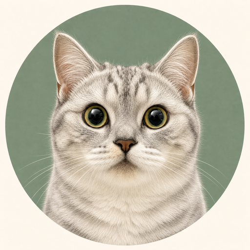
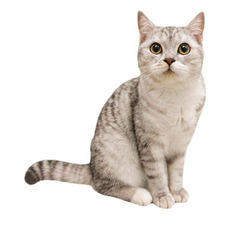

# HelCai DeskPet · 赫尔财

<p align="center">
  
</p>

<p align="center">
  一个自然、轻量、支持多屏交互与自定义宠物素材的 Windows 桌面宠物。
</p>

<p align="center">
  <a href="https://github.com/No-67Helki/helcai-deskpet/actions/workflows/ci.yml"></a>
  <a href="LICENSE"></a>
  <a href="https://github.com/No-67Helki/helcai-deskpet/releases"></a>
</p>

> 当前处于早期公开版本，首发正式支持 Windows 10/11。欢迎试用和反馈问题。

[English README](README_EN.md)

## 预览

<p align="center">
  
</p>

内置桌宠“赫尔财”包含 72 张独立动作帧：待机、行走、坐下、睡眠、开心和拖拽。行走循环包含完整的四足交替步态，待机仅保留轻微呼吸、眨眼和尾尖动作。

## 功能

- 透明、无边框、始终贴地的 Electron 桌宠窗口。
- 16 帧行走步态，动画按实际移动距离同步，避免滑步。
- 使用 `deltaMs` 计算状态和位移，在 60/120/144 Hz 下保持一致速度。
- 透明像素点击穿透，角色实体区域支持点击、拖拽和右键操作。
- 支持多显示器、负坐标、DPI、任务栏工作区与位置持久化。
- 独立“宠物工坊”：导入照片、命名、身份确认、生成、预览、安装和导出。
- 可组合的图像分析与生成 Provider；ComfyUI 仅作为可选高级后端。
- API 密钥使用 Electron `safeStorage` 加密，原始照片不会进入导出的宠物包。
- PetManifest v2 与确定性的本地素材校验、透明化、对齐和打包流程。

## 安装

从 [Releases](https://github.com/No-67Helki/helcai-deskpet/releases) 下载最新 Windows portable 程序并运行。当前安装包尚未进行商业代码签名，Windows SmartScreen 可能在首次启动时显示提示。

## 本地开发

要求：

- Node.js 20 或更高版本
- npm 10 或更高版本
- Python 3.10（仅照片检查、素材打包和相关测试需要）
- Python Pillow

```bash
npm install
npm run typecheck
npm run lint
npm test
npm run build
npm start
```

Windows portable 构建：

```bash
npm run build:win
```

照片和素材工具：

```powershell
python tools/pet_factory/validate_inputs.py inputs/pet-photos
python tools/pet_factory/build_sprite_package.py <contact-sheets> <output> --id my-pet --name "我的宠物"
npm run validate:asset -- <asset-directory>
```

完整动画需要同一只猫或狗的正面脸部、左右侧面、站立全身、坐姿全身和特色花纹六类照片。详细拍摄要求见 [`inputs/pet-photos/README.md`](inputs/pet-photos/README.md)。

## 隐私与模型服务

DeskPet 不运营中转服务器。只有在用户明确授权并开始任务后，照片才会从本机主进程直接发送给所选 Provider。不同 Provider 的数据处理政策、费用和地区可用性由对应服务商决定。

详细说明见 [PRIVACY.md](PRIVACY.md)。请勿在 Issue、日志或公开宠物包中上传 API 密钥和原始私人照片。

## 项目结构

- `src/main/`：窗口、托盘、配置、凭据、宠物库和生成任务。
- `src/renderer/`：桌宠行为、动画、命中检测和移动调度。
- `src/factory/`：React 宠物工坊。
- `src/shared/`：Manifest、项目、Provider 与 Prompt 公共契约。
- `tools/pet_factory/`：照片检查与 72 帧素材打包工具。
- `assets/pets/helcai/`：内置桌宠“赫尔财”的发布素材。
- `docs/`：架构和素材标准。

原始照片目录、生成中间物、API 配置和本地开发工具均被 Git 忽略，不会进入公开仓库或安装包。

## 路线图

- 完成云端 Provider 的公开测试矩阵和错误恢复。
- 完善单状态重试、任务恢复和费用估算。
- 增加更多宠物包、无障碍操作和自动化 UI 回归。
- 在条件允许时提供签名的 Windows 安装程序。

## 参与项目

提交问题或改动前请阅读 [CONTRIBUTING.md](CONTRIBUTING.md)、[CODE_OF_CONDUCT.md](CODE_OF_CONDUCT.md) 和 [SECURITY.md](SECURITY.md)。

## 许可证

代码、文档和仓库内明确发布的内置派生素材采用 [MIT License](LICENSE)。原始宠物照片不属于仓库内容，也未被许可或分发。素材边界见 [ASSETS.md](ASSETS.md)。
